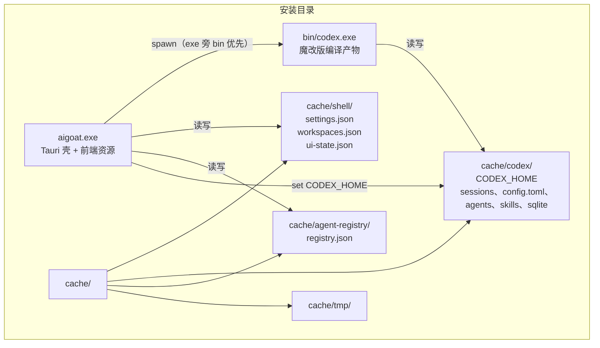

# AIGoat 打包部署方案

> 版本 v1.0（待评审）　2026-10-24
> 文档定位：技术架构设计——部署形态、目录契约、构建流水线、迁移与回滚。

## 1 设计概述

### 1.1 目的与范围

本设计回答三件事如何落地：

1. 魔改后的 codex-rs 源码收进本仓库，落在 `AIGoat/codex-rs/`。
2. 前后端与 codex 子进程产生的全部运行期数据，归拢到安装目录下的 `cache\`，按数据源分类存放。
3. 交付一个 NSIS 安装包，目标机器装完即可用，不依赖已安装的 codex、Node 或 Rust 工具链。

范围之外：跨平台打包（仅 Windows）、代码签名证书申请、CI/CD 搭建。

### 1.2 上游需求与假设

本次无 PRD，以下假设需求来自需求方口头输入，评审时确认：

| # | 假设需求 | 标注 |
|---|---|---|
| A1 | codex-rs 源码随仓库分发，保留 git 历史以便追溯魔改内容与同步上游 | [Hypothesis] |
| A2 | cache 目录位于安装目录内、随应用目录走，不写入 C 盘 AppData（用户明确偏好） | [Hypothesis] |
| A3 | 安装包面向"零依赖"目标机：双击安装、开箱可用 | [Hypothesis] |

### 1.3 约束

| 约束 | 来源 |
|---|---|
| 现有 shell 已跑通 `bridge_*` 命令层与 codex app-server 协议，改造不得破坏该链路 | 代码现状 [Data-backed] |
| 安装目录若为 Program Files 则不可写，cache 必须有可写保障策略 | Windows 目录权限 [Data-backed] |
| codex-rs `target\` 构建产物约 20.9 GB，不得进入仓库 | 磁盘实测 [Data-backed] |
| AIGoat 尚未初始化 git 仓库，无历史包袱 | `git rev-parse` 失败证实 [Data-backed] |

### 1.4 术语

| 术语 | 含义 |
|---|---|
| 壳 | aigoat.exe（Tauri 2 宿主），实现 bridge_* 命令层 |
| codex 子进程 | 壳 spawn 的 `codex app-server`，协议经 stdin/stdout JSONL |
| CODEX_HOME | codex 存放会话、配置、技能等数据的根目录，可由环境变量指定 |
| cache 根 | 安装目录下 `cache\`，本设计的运行期数据唯一归拢点 |

## 2 总体架构

### 2.1 部署形态

单机桌面应用，两个进程 + 一个数据根目录。安装包即"两个 exe + cache 目录契约"。



图读法：aigoat.exe 是唯一入口，按解析顺序拉起 bin 下的 codex.exe；两个进程经 CODEX_HOME 环境变量共享 `cache\codex\`；壳自己的三份配置落 `cache\shell\`，子代理注册表落 `cache\agent-registry\`。四个 cache 子目录按写入方划分，互不交叉。[Data-backed]（现状为四处散落，本设计归拢）

### 2.2 组件职责与边界

| 组件 | 职责 | 不负责 | 依赖 |
|---|---|---|---|
| aigoat.exe | UI、bridge_* 命令层、spawn codex、cache 目录创建与旧数据迁移 | 会话数据存储（由 codex 持久化） | bin/codex.exe、cache\ |
| bin/codex.exe | 会话、rollout、技能、角色文件等全部 agent 数据的读写 | 壳配置 | cache\codex\ |
| NSIS 安装包 | 释放两个 exe 到安装目录 | 预建 cache（由壳首次启动创建） | — |

### 2.3 关键交互

启动时序：壳启动 → 定位 cache 根并创建子目录 → 执行旧数据迁移（拷贝式）→ 设置进程级 `CODEX_HOME` → 首次 bridge_connect 时按解析顺序 spawn codex.exe → 握手后进入既有事件流。运行期交互不变，仍是现有 JSONL 协议链路。[Data-backed]

### 2.4 技术选型

| 选择 | 理由 |
|---|---|
| 安装器沿用 Tauri 内置 NSIS | tauri.conf.json 已配置 targets:["nsis"]，零额外引入 [Data-backed] |
| codex.exe 经 NSIS 安装钩子携带 | 实测 bundle.resources 对该大文件解出 0 字节实体（两次复现）；改用 `installerHooks`（`NSIS_HOOK_POSTINSTALL` 宏 + `File` 指令），由 makensis 原生压缩机制携带 [Data-backed] |
| cache 归拢靠进程环境变量而非配置文件 | CODEX_HOME 是 codex 官方支持的覆盖入口，不侵入 codex 代码 [Research-backed]（codex 官方环境变量约定） |
| 迁移用拷贝不移动 | 升级失败不损毁旧数据，回滚即改回路径 [Expert judgment] |

## 3 现状与差距

| 数据 | 现在的位置 | 代码位置 | 差距 |
|---|---|---|---|
| settings / workspaces / ui-state 三份 json | exe 旁散放，不可写回落 `%APPDATA%\dev.aigoat.app\` | `src-tauri/src/settings/config.rs` | 需改指 `cache\shell\` |
| codex 全部数据 | `~/.codex`（默认，未设 CODEX_HOME） | `src-tauri/src/codex.rs` spawn 处 | 需注入 CODEX_HOME |
| codex 角色文件 agents/*.toml | CODEX_HOME\agents | `src-tauri/src/registry/mod.rs` `codex_agents_dir()` | 随 CODEX_HOME 走 |
| 子代理注册表 registry.json | `~/.agent-registry/`（按 USERPROFILE 拼死） | `registry/mod.rs:149-154` | 需改指 `cache\agent-registry\` |
| codex 可执行文件 | 从 PATH 找 `codex` | `codex.rs` `Command::new("codex")` | 需 exe 旁解析优先 |

魔改源码现状：位于 `.trae\codex-rs\`（项目外），完整 git 仓库，20 个文件未提交修改（codex-api 九个 endpoint、config、core/config、model-provider-info、app-server/account_processor），源码含 .git 约 0.12 GB。[Data-backed]

## 4 模块设计

三个改造模块相互独立，可分阶段实施。

### 4.1 源码迁入模块

职责：把 `.trae\codex-rs\` 完整收进 `AIGoat/codex-rs/`，一次成型。

- 迁入前先在原仓库 commit 魔改内容（20 个文件目前只存在于工作区，误操作即丢失）。
- robocopy 排除：`target\`（20.9 GB）、`node_modules`、`.tmp`、`*.sqlite*` 运行残留；保留 `.git`（约 20 MB）。
- 迁入后验证：`cargo metadata` 可解析即可。**不需要重新编译**——release 产物已存在（`codex-rs\target\release\codex.exe`，与 PATH 中 `D:\Codex\Codex-cli-rs\bin\codex.exe` 同源同尺寸），打包直接收集；仅当日后魔改源码变更时才需要重编。
- `.gitignore` 现有 `**/target` 与 `node_modules` 规则天然覆盖迁入源码，无需改动。[Data-backed]

边界：不改 codex 源码本身，只搬家；构建产物不入仓库。

### 4.2 缓存归拢模块

职责：新增统一的 cache 根定位逻辑，五个数据源全部改指 cache 子目录。

```
cache_root() = exe 所在目录\cache
  ├─ 写探针可写 → 使用
  └─ 不可写 → 回落 %APPDATA%\dev.aigoat.app\cache（兜底，正常安装不触发）
```

| 改动点 | 文件 | 设计 |
|---|---|---|
| cache 根定位 | `settings/config.rs`（或新模块） | 新增 `cache_root()`，写探针失败才回落 AppData，与现有回落思路一致 |
| 壳配置目录 | `settings/config.rs` | `data_dir()` 由「exe 旁」改为「exe 旁 `cache\shell`」 |
| codex 子进程 HOME | `codex.rs` `launch_and_connect` | spawn 前 `std::env::set_var("CODEX_HOME", cache\codex)` |
| 角色文件目录 | `registry/mod.rs` `codex_agents_dir()` | 无需单独改——它读壳进程自身的 CODEX_HOME，4.2 第三行的进程级 set_var 同时覆盖它 |
| 子代理注册表 | `registry/mod.rs:149-154` | `~/.agent-registry` 改为 `cache\agent-registry\` |

一个隐蔽点值得单独说明：若只在 spawn 时用 `.env("CODEX_HOME", ...)`，该变量只进入 codex 子进程环境，壳进程的 `codex_agents_dir()` 读不到，会出现角色文件与 codex 数据分家。因此选进程级 `set_var`，一处设置两处生效。[Expert judgment]

边界：不实现 cache 清理 UI；不改变三个 json 的文件格式。

### 4.3 codex 解析模块

职责：`Command::new("codex")` 改为有序解析，摆脱 PATH 依赖。

解析顺序：

1. exe 旁 `bin\codex.exe` —— 安装形态
2. 环境变量 `AIGOAT_CODEX_EXE` —— 开发调试覆盖
3. PATH 中的 `codex` —— 现有行为兜底

开发机 PATH 里有魔改 codex、用户机器只有捆绑 exe，同一套代码两种形态都成立。[Expert judgment]

边界：不做 codex 版本协商；捆绑 exe 与命令层的协议兼容性靠第 7 节验证兜住。

## 5 构建与部署设计

### 5.1 构建流水线

```mermaid
flow LR
    ART["codex.exe<br/>现成 release 产物<br/>target/release/"] -->|"① 收集复制<br/>（不编译）"| STAGE["src-tauri/bin/<br/>staging"]
    WEB["web/ 前端"] -->|"② npm build"| DIST["web/dist"]
    DIST -->|"③ cargo build<br/>--features custom-protocol"| AIGOATEXE["aigoat.exe"]
    STAGE --> NSIS["④ cargo tauri build<br/>installerHooks + makensis"]
    AIGOATEXE --> NSIS
    NSIS --> PKG["AIGoat_0.1.0_x64-setup.exe"]
```

图读法：① 不编译，直接收集现成产物——`target\release\codex.exe` 与 PATH 中运行验证过的 `D:\Codex\Codex-cli-rs\bin\codex.exe` 同源，复制进 staging 前校验两者尺寸/哈希一致；仅当日后魔改源码变更才重编（`cargo build -p codex-cli --release`，target 已在本地走增量）。② ③ 即现有 `tools/build.ps1` 的两步；④ Tauri CLI 生成 NSIS 工程时注入安装钩子把 codex.exe 带进安装包，随后脚本用同一份工程手动 makensis 重编译并覆盖产物（原因见 5.2）。全程由新增 `tools/package.ps1` 串联并自检产物。[Data-backed]

### 5.2 安装包与安装后拓扑

- codex.exe 的携带方式：`tauri.conf.json` → `bundle.windows.nsis.installerHooks` 指向 `src-tauri\installer-hooks.nsh`（每次打包由脚本动态生成，勿手工编辑）。钩子在 `NSIS_HOOK_POSTINSTALL` 宏里 `CreateDirectory $INSTDIR\bin` + `File /oname=` 落盘 staging 中的 codex.exe，安装后即 `<安装目录>\bin\codex.exe`，与 4.3 解析顺序第一级对应；`NSIS_HOOK_POSTUNINSTALL` 宏在卸载时删除该文件——卸载器的清单不登记钩子装的文件，不补这个宏会残留 300+ MB 的 codex.exe（实测复现）。`cache\` 属用户资产，卸载保留。
- 已知缺陷与绕行：Tauri CLI 直接产出的 setup 安装后钩子数据解成 0 字节文件（两次实测，同钩子最小 NSIS 工程手动编译则正常；CLI 产物的 `Install data` 字节数证明数据已入包，问题出在安装期解压）。`tools/package.ps1` 因此在 CLI 构建后用同一份 `installer.nsi` 手动 makensis 重编译，覆盖 bundle 目录的最终产物——已实测该产物安装出完整 codex.exe。[Data-backed]
- 安装器不预建 cache，壳首次启动 `create_dir_all` 四个子目录，卸载时的 cache 处置由卸载选项决定（见 8 节开放问题）。
- 安装目录：NSIS 允许自选；默认值建议设为非系统盘（如 `D:\AIGoat`），从源头避开 Program Files 不可写问题。装到不可写目录时壳回落 AppData 并在界面明确提示当前缓存位置。[Expert judgment]

### 5.3 产物构成

| 安装后路径 | 来源 | 说明 |
|---|---|---|
| `aigoat.exe` | 步骤 ③ | 前端已嵌入，独立运行 |
| `bin\codex.exe` | 步骤 ① 收集现成产物进 staging | 魔改版编译产物，与迁入源码对应 |
| `cache\`（四子目录） | 运行期生成 | 见 2.1 架构图 |

## 6 迁移与回滚

现有环境（开发机）升级到新布局时的数据迁移：

| 旧位置 | 新位置 | 策略 |
|---|---|---|
| exe 旁三个 json / `%APPDATA%\dev.aigoat.app\` | `cache\shell\` | 旧有新无则拷贝，失败不阻塞启动 |
| `~/.codex` | `cache\codex\` | 同上；数据量大（含全部历史会话），拷贝在后台完成前 codex 继续读旧路径亦可接受，实施时定夺 |
| `~/.agent-registry/registry.json` | `cache\agent-registry\` | 拷贝 |

迁移三条铁律：只拷贝不移动；失败不阻塞启动；拷贝完成前不删任何旧文件。[Expert judgment]

回滚：所有改动是路径与解析顺序调整，git 还原代码即回滚；数据层面旧文件从未被移动或删除，改回旧路径即恢复原状。

## 7 验证设计

在无 codex/Node/Rust 的干净环境（新用户账户即可）执行：

1. 安装包安装，双击 aigoat.exe 可启动。
2. 配置提供商，发消息，收到流式回复——验证捆绑 codex.exe 与命令层协议兼容（AIGoat 协议基线按 codex-cli 0.156.1 校对，捆绑产物是魔改 0.0.0 构建，此项是必过的冒烟）。
3. 全盘检查 exe 旁、`%APPDATA%`、`~/.codex`、`~/.agent-registry` 均无新增文件。
4. `cache\` 四个子目录内容与 2.1 图一致；发一轮会话后 `cache\codex\sessions` 出现 rollout 文件。
5. 注册子 Agent 后 `cache\agent-registry\registry.json` 生成。
6. 重启应用回到上次会话（ui-state 读写正常）。
7. 旧版覆盖安装，配置自动迁入 `cache\shell\`。

## 8 风险与开放问题

风险：

| 风险 | 对策 |
|---|---|
| Program Files 安装导致 cache 不可写 | 默认目录设非系统盘；AppData 兜底 + 界面提示当前缓存位置 |
| 仓库体积增加约 120 MB | 本项目无远程仓库计划，可接受；将来推远程再评估 submodule |
| codex 源码日后变更需重编 | 打包默认取现成产物不触发编译；变更时 `target\` 已在本地，增量编译即可 |
| 未签名安装包触发 SmartScreen 告警 | 本期接受，文档注明「仍要运行」路径；签名证书后续再议 |
| Tauri CLI 的 NSIS 产物安装期解出 0 字节钩子数据（上游缺陷，已绕行） | 脚本固定走手动 makensis 重编译并覆盖产物；步骤④体积自检拦截异常包 |

开放问题（评审时定）：

1. NSIS 默认安装目录给什么值（本方案建议 `D:\AIGoat`）？
2. 卸载时 `cache\` 保留还是提供勾选删除（会话数据属于用户资产，倾向保留）？
3. `~/.codex` 迁移到 `cache\codex\` 是启动时整目录拷贝，还是双 home 过渡（codex 读旧、新会话写新）？
4. codex-rs 的 `.git` 随仓库保留，是否确认（本方案建议保留）？
